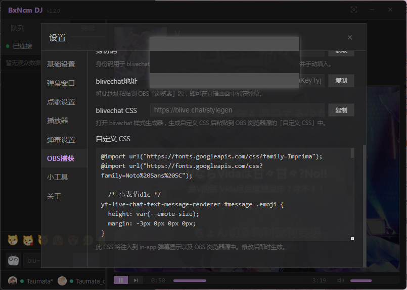
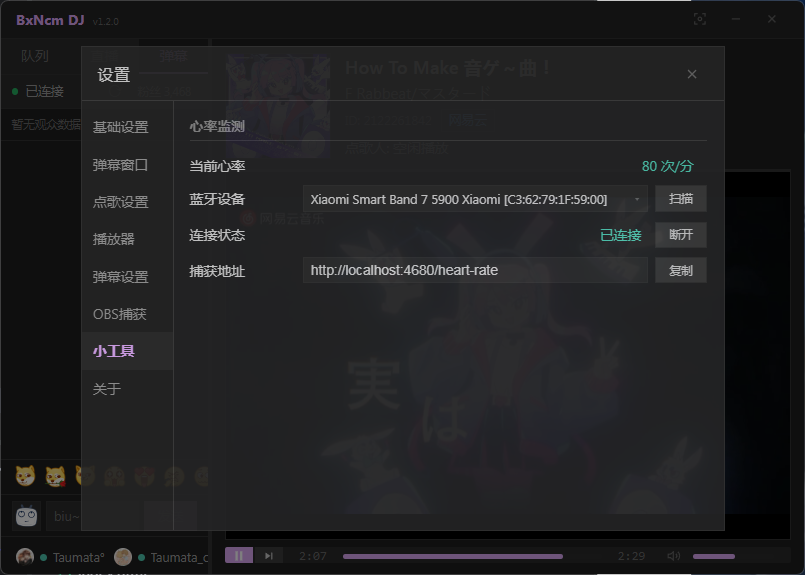
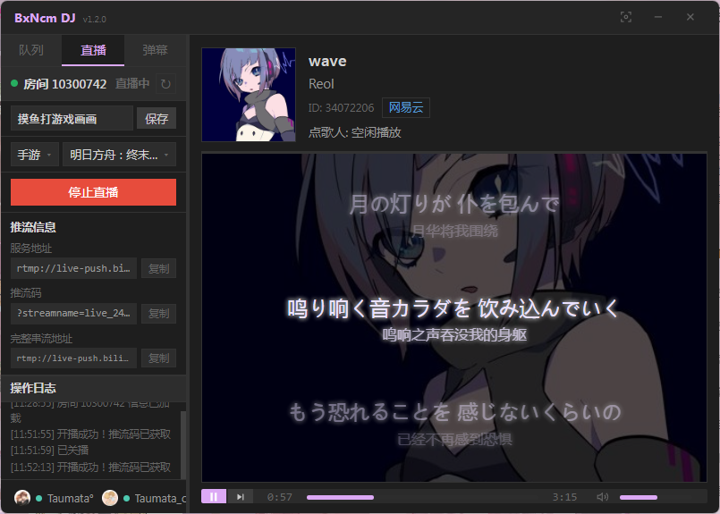
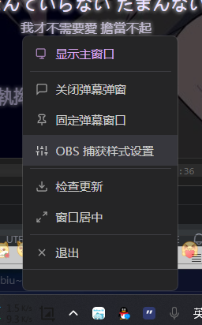

# BxNcm DJ

基于 **Vue 3 + Electron + TypeScript** 的桌面端点歌助手，支持**网易云音乐**和 **Bilibili 视频**双源播放，通过 B站直播间弹幕实现观众点歌互动。

---

## 功能特性


### 音乐播放

- 双源支持：网易云音乐（音频）+ Bilibili 收藏夹/合集（视频）
- 自动切换空闲歌单，无点歌时自动轮播（推荐列表）
- 歌词实时显示，支持翻译和滚动词高亮等
- 视频播放（B站源自动切换视频模式，支持硬件解码优化）
- 音量控制、快进快退、播放队列管理
- 音频/MV/封面预缓存，减少播放延迟
- MV 模式：用视频替代歌词画面，可在设置中切换，支持 MV 自带音频或原始高音质音频两种音源
- 歌词背景图：支持本地图片或当前封面，可调整亮度、模糊、对齐方式
- 歌词样式自定义：颜色、描边、字重、非焦点透明度等
  

### 弹幕点歌与互动

- 自动连接B站直播间，实时接收弹幕
- 支持多种点歌格式：歌名、歌手+歌名、网易云ID、B站 BV 号
- 自由配置冷却时间（用户冷却 / 歌曲冷却）
- 最大队列长度可控制
- 支持发送弹幕表情（B站直播间表情包，支持本地缓存）
- 同时获取直播间 + 个人评论表情包，融合去重
- 通过 blivechat 内嵌弹幕显示，支持自定义 CSS 样式
- 关键词屏蔽、用户屏蔽、等级过滤、勋章等级、新用户/未绑定手机过滤等高级筛选
- 弹幕样式完全可自定义（字体、颜色、轮廓、动画、付费消息等）
  
  
  

### OBS 浏览器源捕获

内置 HTTP + WebSocket 服务器，OBS 浏览器源直接接入。身份码和 blivechat 地址支持显示/隐藏切换，地址可复制，方便分享给其他设备访问。

- **歌词叠加层**：实时歌词 + 翻译显示，支持空闲文本轮播
- **队列叠加层**：当前播放队列可视化
- **歌曲信息叠加层**：当前歌曲标题 / 作者 / 点歌人
- **样式编辑面板**：内嵌 HTTP 页面，实时调整字体、颜色、阴影、背景等外观，自动同步可在右侧预览或 OBS 直接看到效果
- **心率监测页面**：实时心率显示，心形跳动动画，支持样式自定义
- **心率样式编辑面板**：独立页面，可调整心率符号、数字、描边、字体等样式，修改后实时同步
- 端口自动重试：默认 4680，被占用时自动尝试 4681-4710
  

### 心率监测

集成蓝牙 LE 心率监测工具，支持 OBS 捕获和设置页同步显示。

- 通过 Windows WinRT API 扫描 BLE 心率设备（手环/手表）
- 自动编译 C# 工具（首次使用时通过 csc.exe 编译为 heart-rate.exe）
- 设备 ID 与设备名持久化，重启后自动重连（启动加载阶段自动连接，超时 15 秒）
- 多客户端订阅：设置页和 OBS 捕获页可同时显示心率
- 心率推送通过 WebSocket 实时广播，OBS 心形动画随心跳脉动
- 心率显示样式完全可自定义：颜色、描边颜色/宽度/模糊、字体大小/字重/字体、符号文本/大小/颜色/字重/字体、符号与数字间距
- 样式设置通过独立页面（/heart-rate-style）调整，修改后自动持久化并实时推送到 OBS
  

### 直播管理

- 一键开播/下播，自动获取 RTMP 推流地址及推流码
- 支持修改直播间标题和分区
- 人脸认证风控处理：
  - 使用旧版客户端版本号（7.47.0.10269）触发 60024（二维码验证）而非 60043（iframe 内嵌验证）
  - 触发风控时自动调用 stopLive 关播以重置状态
  - 60024/60043 共用同一验证 URL，自动唤起认证窗口
  - 支持轮询 `IsUserIdentifiedByFaceAuth` 检查认证完成状态
- 弹幕实时粉丝数、在线观看（高能榜）缩略显示
- 直播数据获取（房间信息、分区列表、粉丝数等）
- 弹幕发送：支持文本与表情，支持 upower_ 格式表情
  

### 弹幕独立窗口

- 独立透明窗口置顶显示弹幕内容，可自由拖拽、缩放
- 支持固定窗口：固定后上半部分（弹幕区+观众栏）鼠标穿透，下半部分（表情栏+发送框）保持可交互
- 支持固定后收起下半部分表情栏和输入框，仅保留弹幕显示区
- 全局快捷键（默认 Alt+B）快速切换固定/解锁状态
- 支持自定义背景色和窗口透明度
- 支持显示/隐藏边框，边框颜色跟随主题色
- 支持发送文本弹幕和表情弹幕，表情包数据与主窗口共享缓存
- 窗口位置和大小持久化（500ms 防抖保存，±2 像素阈值避免 DPI 累积误差）
  

### 窗口体验

- 无边框自定义标题栏（最小化 / 最大化 / 关闭）
- 窗口置顶 / 可缩放切换
- 主窗口透明度可调（5-100%）
- 窗口位置和大小记忆（使用 `getContentSize()` 保存内容区大小，避免隐形 resize 边框导致的累积误差）
- 关闭到系统托盘（可配置，首次提示记忆）
- 托盘右键菜单：显示主窗口、弹幕弹窗开关、固定/解锁、OBS 样式设置、检查更新、窗口居中、退出
- 明暗主题切换
- 自定义主题色
- 兼容旧版 `bx-ncm-dj` 数据目录（自动检测并复用）

### 数据持久化

- JSON 文件存储（位于 `userData/app-data.json`）
- 三阶段加载策略，优化启动速度：
  - **Boot**（窗口显示前）：主题、主题色、置顶、可缩放、关闭到托盘、自动更新、窗口位置
  - **App**（窗口显示后）：弹幕、播放器、OBS、设置项等软件本体设置
  - **Style**（按需）：OBS 各叠加层样式（`obs_<page>_style`）
- 设置变更通过 300ms 防抖自动保存，关闭时即时 `flush()` 避免数据丢失
- 持久化数据分区：
  - `settings`：键值对（`app_` 前缀为应用设置，`obs_` 前缀为 OBS 样式）
  - `history`：播放历史（最多 200 条，按 songId 去重）
  - `cache`：歌曲信息缓存（最多 50 条）
  - `playlistCache`：歌单/收藏夹缓存（按 source 分组各 10 条，LRU 淘汰）
  - `lastRefreshTime`：歌单刷新冷却记录（60s 冷却，10 分钟 TTL 自动清理）
- 设置导出/导入：导出 `app_` + `obs_` 前缀键，不含登录凭证；导入时采用 merge 模式，仅更新配置文件中存在的键，保留登录信息、窗口位置等未导出字段
- 数据重置：清空所有数据，保留双平台登录状态

### 自动更新

- 基于 GitHub Releases + electron-updater
- 启动后延迟 3 秒自动检查（可在设置中关闭）
- 不自动下载，用户确认后才下载
- 下载进度实时显示
- 安装时自动重启应用
- 托盘菜单可手动触发检查更新

### 其他功能

- 窗口居中到屏幕正中间
- Toast 通知组件（info / success / error / warning 四种类型）
- 自定义下拉选择组件
- 兼容旧版数据目录（`bx-ncm-dj`）
  

### 键盘快捷键

| 快捷键              | 功能                    |
| ------------------- | ----------------------- |
| `Space`           | 播放 / 暂停             |
| `←` / `→`     | 快退 / 快进（长按连续） |
| `↑` / `↓`     | 音量增加 / 减少         |
| `Alt+B`（可配置） | 切换弹幕窗口固定状态    |

---

## 空闲歌单系统

空闲歌单是无人点歌时自动播放的歌曲来源，支持两种源：

- **网易云歌单**：输入歌单 ID（从歌单 URL 中获取，如 `https://music.163.com/playlist?id=8512248857` 中的 `8512248857`）
- **B站视频列表**：支持合集链接、收藏夹链接、分P视频链接

空闲歌单采用**懒加载 + 缓存**策略：

- 启动时优先从本地 `playlistCache` 加载，实现秒开
- 后台异步刷新歌单数据，仅在歌曲列表变化时更新（避免无意义的 UI 抖动）
- 网易云采用**池子模式**：全部歌曲 stub 进池子，播放时随机选取后水合详细信息（批量 API）
- B站采用**全量加载**：idleList 直接含完整信息，逐个水合（并发限制 3 个）
- 歌单播放完毕后自动从 `playlistCache` 重建，实现无限循环播放
- 切换歌单源时零 API 调用，直接从缓存加载
- 歌单刷新冷却 60 秒，避免频繁请求触发风控
  

---

## 技术栈

| 层级       | 技术                               |
| ---------- | ---------------------------------- |
| 框架       | Electron 33                        |
| 前端       | Vue 3 + Pinia + Vue Router         |
| 构建       | Vite 6 + vite-plugin-electron      |
| 语言       | TypeScript 5.7                     |
| 打包       | electron-builder (NSIS)            |
| 更新       | electron-updater (GitHub Releases) |
| OBS 通信   | WebSocket (ws)                     |
| 弹幕       | B站直播 WebSocket 协议 + blivechat |
| 心率监测   | Windows WinRT BLE + C# 工具        |
| 网易云加密 | weapi / eapi / linuxapi            |

---

## 开发指南

### 环境要求

- Node.js >= 18
- npm >= 9
- Windows 10+（心率监测需要 WinRT BLE 支持）
- .NET Framework 4.x（心率工具自动编译需要 `csc.exe`）
- Windows 10 SDK（首次编译心率工具需要 `Windows.winmd`）

### 克隆仓库

```bash
git clone https://github.com/Taumata-wwq/BxNcm-DJ.git
cd BxNcm-DJ
```

### 安装依赖

```bash
npm install
```

> **镜像说明**：`.npmrc` 配置了 `registry=https://registry.npmmirror.com` 用于加速国内安装。electron 二进制和 electron-builder 工具的下载镜像通过环境变量 `ELECTRON_MIRROR` 和 `ELECTRON_BUILDER_BINARIES_MIRROR` 在 `npm run build` 脚本中自动设置，避免 `.npmrc` 中的非标配置项触发 npm 警告。

### 启动开发模式

```bash
npm run dev
```

Vite 启动开发服务器，Electron 窗口自动打开。

### 生产构建

```bash
npm run build
```

构建脚本会：

1. 设置 electron / electron-builder 二进制下载镜像环境变量
2. 清理 `dist/` 与 `dist-electron/` 旧产物
3. 执行 `vite build` 编译渲染进程与主进程
4. 执行 `electron-builder` 打包为 NSIS 安装包

构建产物输出到 `release/` 目录，包含：

- `BxNcm.DJ.Setup.x.x.x.exe` — NSIS 安装包（73 MB 左右）
- `BxNcm.DJ.Setup.x.x.x.exe.blockmap` — 增量更新 blockmap
- `latest.yml` — electron-updater 自动更新元数据

### 类型检查

```bash
npm run typecheck
```

---

## 项目结构

```
BxNcm-DJ/
├── electron/                     # Electron 主进程入口
│   ├── main.ts                   # 主窗口创建、生命周期管理、关闭流程
│   └── preload.ts                # 安全的 IPC 桥接（contextBridge）
├── public/                       # 静态资源
│   └── danmaku-window.html       # 弹幕独立窗口页面
├── src/
│   ├── main/                     # 主进程服务（Node.js 环境）
│   │   ├── ipc/                  # IPC 通信处理
│   │   │   ├── index.ts          # 主入口 + 窗口控制 + 重启
│   │   │   ├── auth.ipc.ts       # 登录认证
│   │   │   ├── danmaku.ipc.ts    # 弹幕连接 + 表情包缓存
│   │   │   ├── live.ipc.ts       # 直播管理
│   │   │   ├── player.ipc.ts     # 播放核心
│   │   │   ├── playlist.ipc.ts   # 队列 + 空闲歌单
│   │   │   └── settings.ipc.ts   # 设置读写 + 数据重置 + 配置导入导出
│   │   ├── services/             # 核心服务
│   │   │   ├── danmaku/
│   │   │   │   ├── danmaku-window.ts  # 弹幕独立窗口服务
│   │   │   │   └── live-ws.ts         # 播放弹幕 WebSocket 客户端
│   │   │   ├── music/
│   │   │   │   ├── bilibili-video.ts  # B站视频获取
│   │   │   │   ├── netease-api.ts     # 网易云 API
│   │   │   │   └── netease-auth.ts    # 网易云认证
│   │   │   ├── obs/
│   │   │   │   ├── index.ts      # OBS 服务入口
│   │   │   │   ├── server.ts     # HTTP + WebSocket 服务器 + 心率监测
│   │   │   │   ├── common.ts     # 公共工具
│   │   │   │   └── pages/        # 六个叠加层页面
│   │   │   │       ├── lyric.ts        # 歌词
│   │   │   │       ├── queue.ts        # 队列
│   │   │   │       ├── songinfo.ts     # 歌曲信息
│   │   │   │       ├── style.ts        # 样式编辑面板
│   │   │   │       ├── heart-rate.ts   # 心率监测页面
│   │   │   │       └── heart-rate-style.ts  # 心率样式编辑面板
│   │   │   ├── player/
│   │   │   │   ├── audio-cache.ts       # 音频/MV/封面缓存
│   │   │   │   └── playlist-manager.ts  # 播放队列管理
│   │   │   ├── tools/                  # 外部工具
│   │   │   │   ├── heart-rate.cs       # 心率监测 C# 源码（WinRT BLE）
│   │   │   │   ├── heart-rate.ps1      # PowerShell 入口脚本（自动编译）
│   │   │   │   └── build.cmd           # 编译辅助
│   │   │   ├── auto-login.ts     # 自动登录
│   │   │   ├── emoticon-cache.ts # 表情包图片缓存
│   │   │   ├── live-manager.ts   # 直播管理（开播/关播/人脸认证/分区/标题/弹幕）
│   │   │   ├── store.ts          # 持久化存储（JSON 文件，三阶段加载）
│   │   │   ├── tray.ts           # 系统托盘（自定义 BrowserWindow 菜单）
│   │   │   └── updater.ts        # 自动更新服务
│   │   └── utils/                # 主进程工具函数
│   │       ├── cookie.ts         # Cookie 管理
│   │       ├── fetch.ts          # HTTP 请求封装（带超时）
│   │       ├── image.ts          # 图片处理（含 data URL 转换）
│   │       ├── netease-crypto.ts # 网易云加密（weapi/eapi/linuxapi）
│   │       └── wbi.ts            # B站 WBI 签名
│   ├── renderer/                 # 渲染进程（Vue 3）
│   │   ├── assets/
│   │   │   └── styles/
│   │   │       ├── global.css    # 全局样式 + CSS 变量
│   │   │       └── danmaku.css   # 弹幕默认 CSS 样式
│   │   ├── components/
│   │   │   ├── chat/             # 弹幕相关
│   │   │   │   └── DanmakuIframe.vue     # blivechat iframe 嵌入
│   │   │   ├── left-sidebar/     # 左侧边栏
│   │   │   │   ├── SidebarTabs.vue       # 标签页切换
│   │   │   │   ├── AccountPanel.vue      # 账户信息
│   │   │   │   ├── PlaylistPanel.vue     # 点歌队列 + 搜索
│   │   │   │   ├── DanmakuPanel.vue      # 弹幕互动
│   │   │   │   └── LivePanel.vue         # 直播管理
│   │   │   ├── player/           # 播放器
│   │   │   │   ├── AudioPlayer.vue       # 音频播放
│   │   │   │   ├── VideoPlayer.vue       # 视频播放
│   │   │   │   ├── CoverDisplay.vue      # 封面展示
│   │   │   │   ├── LyricsDisplay.vue     # 歌词显示
│   │   │   │   ├── ProgressBar.vue       # 进度条 + 音量
│   │   │   │   └── SongInfo.vue          # 歌曲信息
│   │   │   ├── settings/         # 设置
│   │   │   │   ├── SettingsModal.vue     # 设置弹窗
│   │   │   │   ├── CloseToTrayDialog.vue # 关闭到托盘对话框
│   │   │   │   ├── UpdateNotificationDialog.vue # 更新通知对话框
│   │   │   │   ├── ColorPicker.vue       # 颜色选择器
│   │   │   │   ├── CustomSelect.vue      # 自定义下拉选择
│   │   │   │   ├── ToastNotification.vue # Toast 通知组件
│   │   │   │   └── ConfirmDialog.vue     # 确认对话框
│   │   │   └── titlebar/
│   │   │       └── TitleBar.vue          # 自定义标题栏
│   │   ├── stores/               # Pinia 状态管理
│   │   │   ├── settings.store.ts # 设置状态（三阶段加载 + 防抖保存）
│   │   │   ├── auth.store.ts     # 认证状态
│   │   │   ├── danmaku.store.ts  # 弹幕状态
│   │   │   ├── player.store.ts   # 播放器状态
│   │   │   └── playlist.store.ts # 播放列表状态
│   │   ├── views/                # 页面视图
│   │   │   ├── LoginView.vue     # 登录页（双平台扫码）
│   │   │   └── MainView.vue      # 主界面
│   │   ├── router/
│   │   │   └── index.ts          # 路由配置（Memory History）
│   │   ├── App.vue               # 根组件（启动状态机 + 关闭前保存）
│   │   └── main.ts               # Vue 应用入口
│   ├── env.d.ts                  # 全局类型声明（window.electronAPI 等）
│   └── shared/                   # 主进程与渲染进程共享
│       ├── types/
│       │   ├── settings.ts       # 设置类型定义（AppSettings + DanmakuStyleConfig + Obs*Style）
│       │   ├── danmaku.ts        # 弹幕类型定义
│       │   ├── player.ts         # 播放器类型定义
│       │   └── song.ts           # 歌曲类型定义
│       ├── constants/
│       │   └── defaults.ts       # 默认设置值
│       └── utils/
│           └── audio.ts          # 音频工具函数
├── build/                        # 构建资源（图标）
│   └── icon.ico
├── scripts/
│   └── after-pack.cjs            # 打包后精简脚本
├── electron-builder.yml          # 打包配置
├── vite.config.ts                # Vite 构建配置
├── tsconfig.json                 # TypeScript 配置
├── tsconfig.node.json            # Vite 配置的 TS 配置
├── index.html                    # Vite 入口 HTML
├── .gitignore
├── .npmrc                        # npm registry 镜像配置
└── package.json
```

---

## 架构说明

### 进程模型

项目遵循 Electron 标准的**主进程 / 渲染进程**分离架构：

- **主进程**（`src/main/`）：运行在 Node.js 环境，负责文件系统操作、网络请求、WebSocket 连接、播放器控制、直播管理、心率监测等底层功能。通过 `electron/preload.ts` 中的 `contextBridge` 暴露安全的 API 给渲染进程。
- **渲染进程**（`src/renderer/`）：运行在 Chromium 环境，使用 Vue 3 构建 UI。通过 `window.electronAPI` 调用主进程功能，不直接访问 Node.js API。
- **共享层**（`src/shared/`）：TypeScript 类型定义和常量，两端均可引用。

### 数据流

```
用户操作 → Vue 组件 → Pinia Store → IPC (invoke/send) → 主进程服务 → 外部 API
                                                                   ↓
UI 更新 ← Vue 响应式 ← Pinia Store ← IPC (on 事件) ← 主进程服务结果
```

### 设置持久化

采用**三阶段加载**策略，优化启动速度：

1. **Boot**（窗口显示前）：主题、主题色、置顶状态、可缩放、关闭到托盘、自动更新、窗口位置
2. **App**（窗口显示后）：软件本体设置（弹幕、播放器、OBS、空闲歌单等，排除 `app_` 与 `obs_` 前缀键）
3. **Style**（按需）：OBS 各叠加层样式（`obs_<page>_style`，由 OBS 服务读取）

设置变更通过 300ms 防抖自动保存，关闭时即时保存避免数据丢失。

### 弹幕系统

弹幕通过 **blivechat iframe**（`DanmakuIframe.vue`）嵌入 blivechat 页面，支持通过 URL 参数配置和自定义 CSS 注入。

弹幕数据通过主进程的 WebSocket 连接 B站直播间获取（`live-ws.ts`），支持：

- 自动重连（基于心跳包检测）
- 同时维护在线观众列表（高能榜 + 直播间进入事件）
- 点歌指令解析（网易云 + B站双源）
- 弹幕、礼物、SC、醒目留言、超级留言转发到渲染进程
- 表情包数据缓存到本地（避免重复请求）

### 直播管理流程

开播流程包含风控自动恢复机制：

1. 获取服务器时间戳
2. 使用静态旧版本号（7.47.0.10269）构建签名参数
3. 调用 `startLive` 接口
4. 若返回 60024 / 60043（人脸认证风控）：
   - 自动调用 `stopLive` 关播以重置服务端状态
   - 唤起人脸认证窗口（共享 session，避免重新登录）
   - 前端轮询 `IsUserIdentifiedByFaceAuth` 检查认证完成
5. 认证完成后用户可重新开播

### 心率监测架构

```
[C# heart-rate.exe (WinRT BLE)] 
        ↓ stdout (JSON)
[PowerShell heart-rate.ps1]
        ↓ stdout (JSON)
[Node.js spawn (server.ts)]
        ↓ dispatchHrMessage()
[WebSocket 广播]
   ├── 设置页（订阅）
   └── OBS 捕获页（订阅）
```

- C# 工具使用 Windows WinRT BluetoothLEDevice API 扫描和连接 BLE 心率设备
- PowerShell 脚本负责自动编译（首次使用）和调用 exe
- Node.js 通过 `child_process.spawn` 启动 PowerShell 进程，解析 stdout JSON 消息
- 设备 ID 与设备名持久化到设置（`lastHeartRateDevice` / `lastHeartRateDeviceName`），重启后自动重连
- 多客户端订阅模式：设置页和 OBS 捕获页可同时显示心率

---

## 使用说明

### 首次启动

1. 分别扫码登录 B站 和 网易云音乐
2. 配置空闲歌单（网易云歌单 ID + B站收藏夹链接）
3. 按需调整各种设置项

### 弹幕点歌格式

观众在直播间发送以下格式的弹幕即可点歌：

| 格式                | 示例                    | 说明           |
| ------------------- | ----------------------- | -------------- |
| `点歌 歌名`       | `点歌 春日影`         | 搜索网易云音乐 |
| `点歌 歌手 歌名`  | `点歌 春日影 CRYCHIC` | 精确搜索       |
| `点歌 id:xxxxxxx` | `点歌 id:2154464431`  | 网易云歌曲 ID  |
| `点歌 BVxxxxxx`   | `点歌 BV1EGKMebEyJ`   | B站视频 BV 号  |

> 触发关键词支持繁体「點歌」，必须以「点歌 + 空格」开头，纯表情弹幕不处理。

### blivechat 弹幕显示

在设置中开启「弹幕捕获」后，系统会自动获取身份码并构建 blivechat 地址。

弹幕显示区域的样式可通过设置中的「自定义 CSS」文本框修改（兼容 blivechat stylegen 生成的经典样式 CSS）。

---

## OBS 配置

1. 在软件设置中启用「OBS 叠加层」
2. 点击「打开」按钮打开样式设置面板
3. 在 OBS 中添加「浏览器」源，填入对应 URL：
   - 歌词：`http://localhost:4680/lyric`
   - 队列：`http://localhost:4680/queue`
   - 歌曲信息：`http://localhost:4680/songinfo`
   - 样式编辑：`http://localhost:4680/style`
   - 心率：`http://localhost:4680/heart-rate`
   - 心率样式编辑：`http://localhost:4680/heart-rate-style`
4. 将 OBS 浏览器源放到需要的位置即可
5. 在样式面板中实时调整字体、颜色、阴影等外观，自动同步可在右侧预览或 OBS 直接看到效果

> 端口默认 4680，被占用时会自动尝试 4681-4710。


---

## 设置项分类

设置项分为以下几大类，均通过 `app_` 前缀持久化到 store：

| 分类      | 关键字段                                                                                                                                                                                                                     | 说明                    |
| --------- | ---------------------------------------------------------------------------------------------------------------------------------------------------------------------------------------------------------------------------- | ----------------------- |
| 直播间    | `roomId`                                                                                                                                                                                                                   | 房间号                  |
| 点歌冷却  | `userCooldown` / `songCooldown` / `maxQueueSize`                                                                                                                                                                       | 用户/歌曲冷却，最大队列 |
| 空闲歌单  | `neteasePlaylistId` / `bilibiliFavUrl` / `lastIdleSource` / `idleQueueSize`                                                                                                                                          | 歌单配置与来源          |
| 界面      | `theme` / `accentColor` / `alwaysOnTop` / `resizable` / `windowOpacity`                                                                                                                                            | 主题与窗口              |
| 弹幕窗口  | `danmakuWindow` / `danmakuWindowFixed` / `danmakuWindowShowBorder` / `danmakuWindowCollapseInput` / `danmakuWindowOpacity` / `danmakuWindowBgColor` / `danmakuWindowFixShortcut`                                                                | 弹幕独立窗口            |
| 弹幕显示  | `showDanmaku` / `showPaidMessages` / `showGiftName` / `mergeSimilarDanmaku` / `mergeSimilarGift` / `minPaidMessagePrice` / `maxDanmakuCount` / `showDanmakuTime` / `showIdleSongs` / `showDebugMessages` | 显示控制                |
| 弹幕屏蔽  | `blockGiftDanmaku` / `blockMirrorMessages` / `blockKeywords` / `blockUsers` / `blockLevel` / `blockMedalLevel` / `blockNewbie` / `blockNotMobileVerified`                                                    | 屏蔽规则                |
| 弹幕样式  | `danmakuStyle` / `customDanmakuCss`                                                                                                                                                                                      | StyleGenerator 配置     |
| 歌词      | `showLyricTranslation` / `splitLyricTranslation` / `lyricDelay` / `lyricFontSize` / `lyricLineSpacing` / `idleLyricText`                                                                                         | 主界面歌词              |
| 歌词背景  | `lyricBgEnabled` / `lyricBgSource` / `lyricBgPath` / `lyricBgAlign` / `lyricBgBrightness` / `lyricBgBlur` / `lyricBgOpacity`                                                                                   | 背景图                  |
| 歌词样式  | `lyricColor` / `lyricStrokeColor` / `lyricStrokeWidth` / `lyricStrokeBlur` / `lyricFontWeight` / `lyricTrans*` / `lyricInactiveOpacity`                                                                        | 颜色与描边              |
| 直播分区  | `liveParentAreaIdx` / `liveSubAreaId`                                                                                                                                                                                    | 默认分区                |
| 播放器    | `volume` / `mvMode` / `mvAudioSource`                                                                                                                                                                          | 音量、MV 模式与音源      |
| OBS       | `obsOverlayEnabled` / `obsLyricStyle` / `obsQueueStyle` / `obsSongInfoStyle`                                                                                                                                         | OBS 叠加层              |
| blivechat | `identityCode` / `blivechatLang`                                                                                                                                                                                         | 身份码与语言            |
| 心率      | `lastHeartRateDevice` / `lastHeartRateDeviceName` / `heartRate*`                                                                                                                                                | 蓝牙心率设备与显示样式  |
| 窗口行为  | `closeToTray` / `autoUpdate`                                                                                                                                                                                             | 托盘与更新              |
| 分隔线    | `splitterLeft` / `splitterUpper`                                                                                                                                                                                         | 主界面布局              |

---

## 打包说明

### 构建命令

```bash
npm run build
```

### 镜像配置

`.npmrc` 仅保留 npm registry 镜像（`https://registry.npmmirror.com`）。electron 二进制和 electron-builder 工具的下载镜像通过环境变量在 `npm run build` 脚本中设置：

- `ELECTRON_MIRROR=https://npmmirror.com/mirrors/electron/`
- `ELECTRON_BUILDER_BINARIES_MIRROR=https://npmmirror.com/mirrors/electron-builder-binaries/`

这种迁移方式避免了 npm 9+ 对 `.npmrc` 中非标配置项的警告。

### 打包配置

打包配置位于 `electron-builder.yml`，主要选项：

- 目标平台：Windows (x64, NSIS 安装包)
- 压缩级别：maximum
- ASAR 打包：启用（ws、qrcode、electron-updater 模块解包）
- 安装选项：自定义安装路径、桌面快捷方式、开始菜单
- 自动更新：发布到 GitHub Releases（latest.yml + blockmap）

### 构建产物精简

`scripts/after-pack.cjs` 在打包后自动执行，移除不必要的文件：

- 多余语言包（仅保留中英文）
- PDF 查看器（pdf.dll）
- 崩溃上报程序（crashpad_handler.exe）

### 版本号

版本号在 `package.json` 中维护，通过 Vite 的 `define` 注入到应用中（`__APP_VERSION__`），在登录页底部显示。

---

## 许可证

MIT License

## 作者

Taumata
